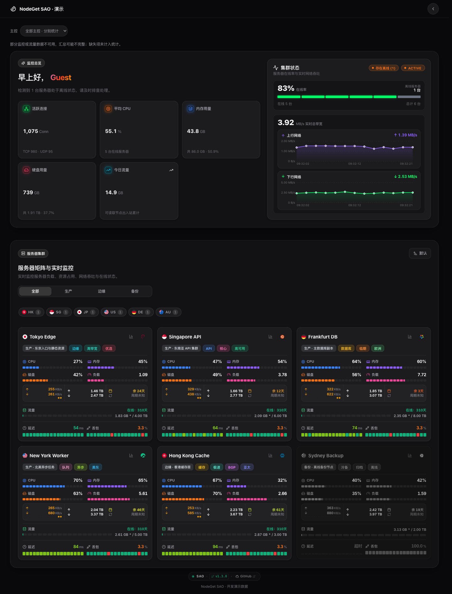

# NodeGet-Theme-SAO

面向 **NodeGet v0.6.0 与当前 v0.6.1 beta** 的原生 SAO 风格公开监控主题。通过 NodeGet WebSocket RPC 读取节点、任务与流量，提供卡片、方格矩阵、波形看板、浅色/深色模式、配色和点阵编辑器。



## 功能

- 首页多种节点卡片、搜索、分组、排序和多主控筛选。
- 节点详情、实时资源使用率、历史负载与网络曲线。
- 自动发现 NodeGet Ping/TCPing 任务，显示真实延迟与丢包；支持指定首页任务。
- 今日流量、周期流量、节点费用与到期提醒；费用默认不公开。
- SAO / EVA / 命运石之门配色，开屏动效、点阵预设和自定义颜色。
- 主题编辑器在当前浏览器自动保存，支持导入、导出完整配置和恢复站点设置。
- NodeGet 标准 ZIP 与独立静态部署；主题中不包含服务器管理、后台跳转或管理员登录入口。

多主控节点按“主控身份＋节点 UUID”区分。同一台服务器同时上报两个主控时，会显示两条记录，并分别参与总览和费用统计；主题不自动把它们合并为备用来源。建议为每个连接设置固定且唯一的 `id`，修改显示名称或调整连接顺序时保留这个 `id`。

## 安装

### NodeGet 后台安装

1. 从本仓库 [Releases](https://github.com/GarlandQian/NodeGet-Theme-SAO/releases) 下载主题 ZIP；没有可用发布包时，按下文自行构建。
2. 在 NodeGet 控制面板的主题管理中，从本地压缩包安装。
3. 展开已安装的 SAO 主题，进入 **Token 授权**，点击一个主控预设，或用“添加空白”填写名称、后端 URL 和公开只读 Token，然后点击 **确定**。
4. 打开主题页面；如果页面已经打开，点击“已保存授权，重新读取”。

**安装 ZIP 不会自动授权读取当前主控。** “用户配置”只管理主题偏好，“Token 授权”才会保存 `config.json.site_tokens`。若提示“尚未添加主控授权”，先检查该主题的 Token 授权列表是否为空、是否点了“确定”；不需要把 Token 发给主题作者或提交到 GitHub。官方操作由 [NodeGet 主题详情中的 Token 授权](https://github.com/NodeSeekDev/NodeGet-board/blob/main/src/components/theme-management/ThemeDetail.vue) 提供。

ZIP 根目录直接包含 `index.html`、`assets/`、`nodeget-theme.json`、`nodeget-theme-files.json`、`config.json`、`custom.css`、`custom.js` 和预览图，不额外套一层 `dist/`。

### 独立静态部署

解压主题 ZIP，编辑 `config.json`，再把全部文件部署到 nginx、Cloudflare Pages、GitHub Pages 等静态托管服务。也可关联本仓库，使用以下构建配置：

| 配置项 | 值 |
| --- | --- |
| Node.js | 22.12 或更新版本 |
| 安装命令 | `npm ci` |
| 构建命令 | `npm run build` |
| 输出目录 | `dist` |
| 环境变量 | `NODEGET_CONFIG`，值为完整 JSON 配置 |

`NODEGET_CONFIG` 在构建时生成 `dist/config.json`，改动环境变量后需要重新构建。它不注入 JavaScript bundle。使用子路径部署时保留整个文件结构；页面采用 Hash 路由，例如 `/monitor/#/instance/...`，无需服务端 SPA rewrite。

作为公开主题分发站时，部署不含真实连接的默认构建，并允许跨域读取静态文件。仓库提供适用于 Cloudflare Pages 的 `_headers`；其他托管服务请设置相应 CORS 头。NodeGet 控制面板可以从分发站 URL 导入主题。`nodeget-theme.json` 中的 `dist_page` 暂留空，可在确定自己的分发域名后填写。本仓库不预设已上线的分发站。

## 站点配置

```json
{
  "user_preferences": {
    "site_name": "我的节点监控",
    "site_logo": "",
    "footer": "Powered by NodeGet · SAO",
    "theme_settings": {
      "showPriceForGuests": false
    }
  },
  "site_tokens": [
    {
      "id": "primary",
      "name": "主控一",
      "backend_url": "wss://your-backend.example.com/nodeget/rpc",
      "token": "YOUR_PUBLIC_READ_ONLY_TOKEN"
    }
  ]
}
```

`backend_url` 使用自己服务端实际的 WebSocket RPC 地址。每个 `site_tokens` 条目对应一个主控；新增条目即可聚合其他主控。

`config.json` 会被访客浏览器读取。这里只能配置有意提供给公开页面、限制了节点及字段范围的只读 Token，不能放入 Super Token 或写入凭据。授予需要展示的节点、监控数据、`metadata_*`、Ping/TCPing 任务及流量读取权限即可。隐藏按钮或关闭费用展示不能替代服务端权限限制。

费用默认关闭。站长在部署配置的 `user_preferences.theme_settings.showPriceForGuests` 中设置 `true` 后，费用与资产页面才向访客开放。浏览器本地的个性化设置不能越过站点开关；截图防窥仅隐藏当前屏幕上的金额，不提供管理员专属查看权限。

### 编辑与应用主题设置

1. 在主题中打开“主题设置”，调整布局、配色、点阵或任务绑定，改动会保存到当前浏览器。
2. 导出 `user_preferences` 配置。导出文件不包含 `site_tokens` 或 Token。
3. 在 NodeGet 后台主题配置的完整 JSON 编辑器中应用导出的偏好；若直接编辑 `config.json`，替换其中的 `user_preferences`，保留自己的 `site_tokens`。
4. 独立静态托管也可更新 `NODEGET_CONFIG` 的 `user_preferences` 后重新构建部署。

更换浏览器或设备不会自动同步本地编辑。全站配置应用后，其他访客才会读取到新设置；已有本地覆盖的浏览器可使用“恢复站点设置”清除覆盖。

主题刻意不声明简化的 `user_preferences_form`，以便 NodeGet 后台使用完整 JSON 编辑器。这样能保留点阵预设、Ping 绑定、颜色对象等复杂字段，避免简化表单保存时丢弃未知配置。

## 数据与版本差异

本主题仅接入 NodeGet 原生接口及其扩展，包括第三方 NodeGet 扩展；不提供 Komari 等其他探针程序的协议适配。

- 支持正式版 v0.6.0 的流量接口与当前 v0.6.1 beta 拆分后的接口，通过能力识别适配；不维护 v0.5.x。
- 费用、到期日、标签和分组来自 NodeGet 节点元数据，没有配置时显示缺失状态。到期日期独立读取；关闭费用公开不会隐藏已授权的到期日期，金额、币种和账期仍遵守费用公开设置。
- Ping/TCPing 直接读取 NodeGet 已有任务及执行记录。首页默认自动选择节点的可用任务，无需先在主题中绑定；也可在主题设置中指定任务。没有任务、没有样本或读取权限不足时分别提示，主题不创建任务、不生成模拟延迟或丢包。
- Ping 按节点逐步显示完整区间统计，慢节点不会拖住其他节点；首页总览只读取今日流量合计，速率历史按需加载。单线模式中的“全选节点”可直接将当前搜索结果切换到另一条线路，搜索范围外的绑定保持不变。
- 历史周期流量依赖 NodeGet 的流量快照。按官方流程安装并运行 `traffic-snapshot-worker`；快照不足、数据缺口或权限不足时，主题会显示原因，不把它们当作零流量。
- 主控连接失败、无权限或数据未配置时，其他主控和不受影响的功能继续工作；汇总不完整时会提示。

官方资料：[主题开发](https://nodeget.com/dev/theme/)、[主题安装](https://nodeget.com/guide/theme/quick-install)、[流量统计](https://nodeget.com/guide/features/traffic)、[节点元数据约定](https://nodeget.com/api/kv/special)、[版本变更](https://github.com/NodeSeekDev/NodeGet/releases)。

### 流控扩展

兼容 [34892002/nodeget 的 extension-traffic](https://github.com/34892002/nodeget/blob/503e39f20138aac597c87ba3071668c829050cc4/extension-traffic/extension-dist.zip)。主题读取扩展配置的配额与 `metadata_traffic_used` 周期已用量，按上传和下载的合计展示；扩展中的 GB 配额按 GiB 换算。扩展只提供合计时，详情也显示合计。

该 ZIP 只有配置界面。还需在 NodeGet 后台配置并运行扩展的 [worker-traffic-reset.js](https://github.com/34892002/nodeget/blob/503e39f20138aac597c87ba3071668c829050cc4/extension-traffic/worker-traffic-reset.js)，由 Worker 初始化周期起点并持续发布用量。脚本建议每小时运行；主题更新不会替代这一步。只有配额、没有周期用量时，主题显示“等待流量扩展初始化周期”。

已核对的发布包对应提交 `503e39f`。其 Worker 的月周期为从初始化或重置时刻起算的固定 30 天；按量计费和永不重置显示为不限量。主题遵循扩展发布的数据，不在浏览器重置或补造流量。缺少起点的已发布用量会标记不完整，过期周期会提示等待 Worker 更新。今日流量及速率历史仍来自 NodeGet 原生记录，不能用周期累计量替代。

## 本地开发与打包

```bash
npm ci
cp .env.example .env.local
npm run dev
```

在 `.env.local` 中填写 `NODEGET_CONFIG`。开发服务器通过 `/config.json` 响应提供配置；文件已被 Git 忽略。没有后端时可使用开发模式的 `?mock=1` 预览，`?mock=0` 退出。

```bash
npm run build
npm run package
```

`npm run build` 完成类型检查、Vite 构建、配置与主题元信息生成。`npm run package` 生成仓库根目录的 `NodeGet-Theme-SAO-v1.3.8.zip`。版本以 `package.json` 为准；更新版本时同步根目录 manifest。

**分发 ZIP 始终使用空 `site_tokens` 模板**，即使本次构建设置了 `NODEGET_CONFIG`。实际站点配置只保留在 `dist/config.json` 中；直接发布 `dist/` 前应确认它是个人站点还是公开分发站。

现有检查命令：

```bash
npm run lint
npm test
npm run typecheck
```

自定义 CSS / JS 可放在 `custom.css` 和 `custom.js`，更新主题前请备份这些文件及站点配置。

## 使用 GitHub Actions 发布 Release

推送到 `main` 后，**Release NodeGet theme** 工作流会自动选择下一个补丁版本（例如 `1.3.8 → 1.3.9`），执行 Lint、测试、构建和 ZIP 校验，然后发布 GitHub Release；配置 Cloudflare 后还会自动部署分发站。无需手动打标签或点击工作流。

工作流根据已有正式标签递增补丁版本，并同步 `package.json`、`package-lock.json` 和 `nodeget-theme.json`。所有检查通过后，才将自动版本提交和 `v<version>` 标签一起推送，再上传主题 ZIP、预览图及 `SHA256SUMS`。自动提交使用仓库内置 `GITHUB_TOKEN`，不会循环触发发布，也无需配置个人 Token。自动版本提交会回写 `main`，下次本地开发前先同步远端。

若需要升到次版本或主版本，可在推送前将上述三个文件同步设为更高版本，工作流会使用该版本。也可推送与代码版本一致、位于 `main` 历史中的 `v*` 标签；带 `-beta.1` 等后缀的版本标记为预发布。

发布串行执行，较新的源代码推送会取代尚未发布的旧运行。已有标签和 Release 不会被覆盖。失败后可以重跑原运行，或在 **Actions → Release NodeGet theme → Run workflow** 中选择 `main` 恢复；已经推送的自动版本提交和已经发布的完整 Release 会被复用，继续完成后续部署。

若附件上传中断后留下草稿或不完整 Release，工作流会停止并说明原因，需要先处理该 Release 再重跑；已完整发布但 CF 部署失败的版本可以直接重跑部署工作流。

发布说明可写在 `.github/release-notes/v<version>.md`，否则使用默认安装说明。安装时下载 **Releases 附件中的 `NodeGet-Theme-SAO-v<version>.zip`**；Actions Artifact 的外层压缩包还包含预览图和校验和，不能直接当作主题安装。

## 自动部署 Cloudflare Pages 分发站

正式 Release 发布成功后，可以自动将该 Release 的 ZIP 解压部署到 Cloudflare Pages，再用固定的 Pages 地址从 NodeGet 后台远程导入或更新主题。部署复用已发布且通过 SHA256 校验的 ZIP，不会重新构建或带入本地 `.env`。这是 NodeGet [规范主题](https://nodeget.com/dev/theme/)支持的静态分发方式。

在 GitHub 仓库 **Settings → Secrets and variables → Actions** 中一次性配置：

| 类型 | 名称 | 内容 |
| --- | --- | --- |
| Secret | `CLOUDFLARE_API_TOKEN` | 仅对目标账户授予 **Account → Cloudflare Pages → Edit** 的 API Token |
| Secret | `CLOUDFLARE_ACCOUNT_ID` | 目标 Cloudflare 账户 ID |
| Variable | `CLOUDFLARE_PAGES_PROJECT` | 专用 Pages 项目名，例如 `nodeget-theme-sao` |

API Token 按 [Cloudflare CI 文档](https://developers.cloudflare.com/pages/how-to/use-direct-upload-with-continuous-integration/)创建，并直接填入 GitHub Secret。首次运行会创建同名 Pages 项目，生产分支为 `main`；同名项目已存在时会复用，因此请填写用于该主题分发的专用项目名。Cloudflare 的实际 `pages.dev` 域名由 API 返回，不需要事先猜测或手填。

- **已有 Release 首次上线**：在 Actions 中选择 **Deploy release to Cloudflare Pages → Run workflow**，分支选 `main`，`release_tag` 留空会部署最新正式版，也可明确填写当前最新正式版，例如 `v1.3.8`。
- **后续自动更新**：推送 `main` 即可自动递增版本、发布正式 Release，并部署到相同的 Pages 地址。预发布版本不更新这个稳定分发地址。
- **在 NodeGet 导入**：成功后的 Actions Summary 会显示 **Import URL**。将该根地址填写到 NodeGet 的远程主题导入界面；导入后在 NodeGet 后台配置自己的主控授权。

工作流会填入主题的 `dist_page`，保留空的 `config.json.site_tokens`，配置跨域响应头，并逐文件核对线上内容与 CORS。Cloudflare 消费的 `_headers` 不列入 NodeGet 下载清单。生产部署串行运行，仅允许最新正式版上线；部署失败后可单独重跑部署工作流，无需重新发布已有 Release。

未配置 `CLOUDFLARE_PAGES_PROJECT` 时，原 GitHub Release 流程照常运行并跳过 Pages 部署。设置项目变量前，请先配置两个 Secret。

## 来源与许可证

保留上游 [MIT License](./LICENSE) 及作者版权。原 SAO 主题由 **WAOR** 开发，本仓库由 **GarlandQian** 适配 NodeGet。

感谢 [SAO 原作及其社区贡献者](https://github.com/WAOR/Komari-Theme-SAO) 的设计与实现，以及 [NodeGet](https://github.com/NodeSeekDev/NodeGet) 项目。
